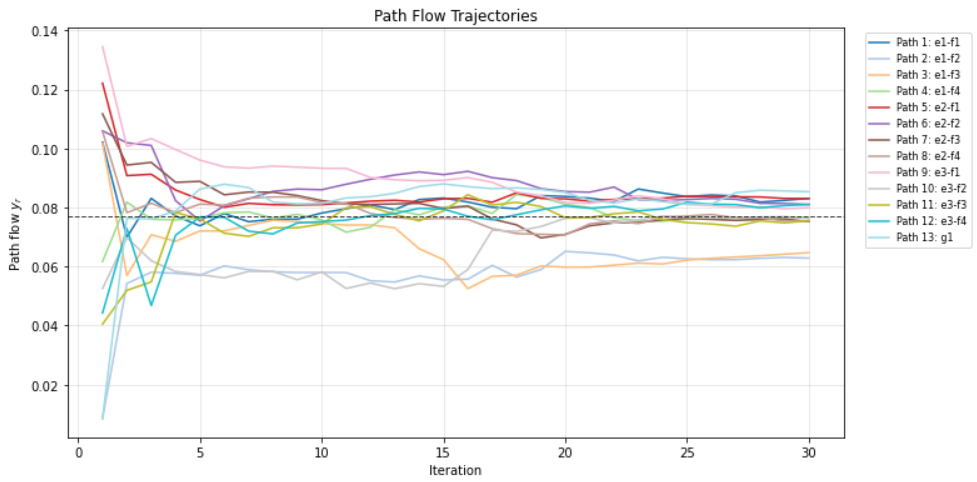
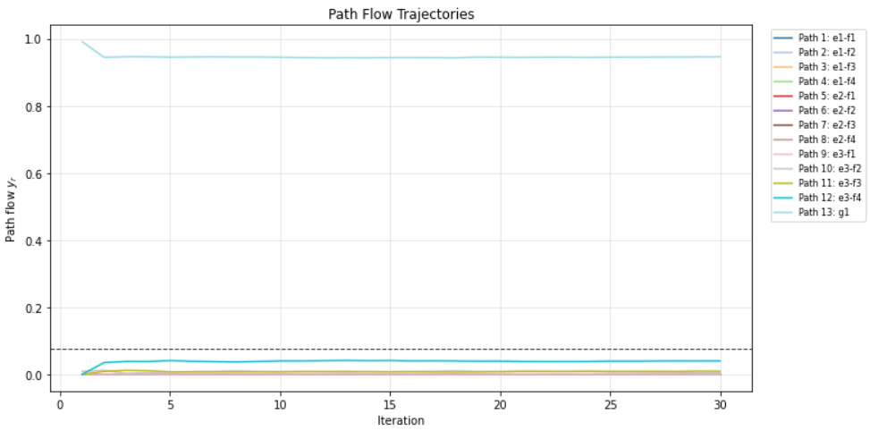
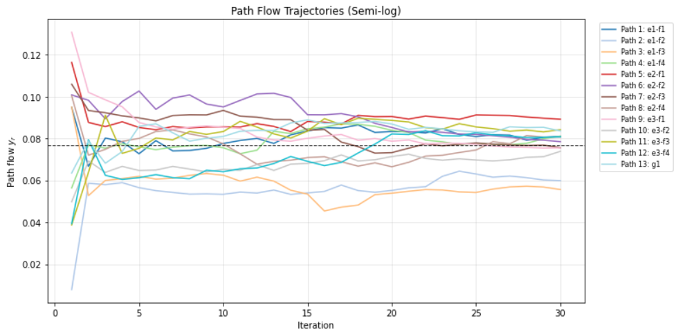
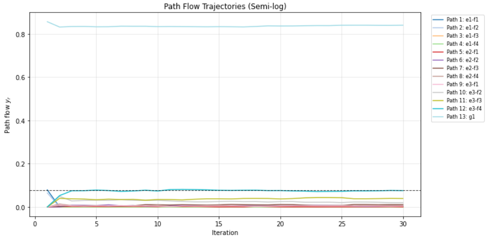
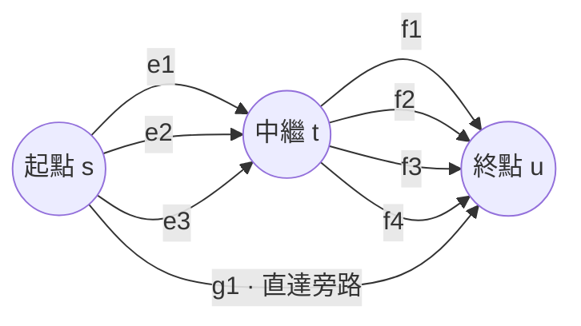

# Congestion Control Learning

**壅塞控制學習的論文數值實驗**

以 Python 與 Jupyter Notebook 模擬參數估計、價格更新和流量分配，包含原始兩路模型，以及 **8 條邊、13 條路徑**的串並聯網路實驗。程式提供價格驅動與最佳化式流量生成，並包含線性及 semi-log 訊號模型。

[](#參數與再現性)
[](#實驗導覽)
[](LICENSE)

## 實驗預覽

以下四張是論文使用的原始圖片，展示各路徑的流量隨迭代變化。這四張圖的圖例包含全部 13 條路徑；完整的參數、價格與流量圖片可見[圖片索引](docs/figures/README.md)。

<table>
  <tr>
    <th>線性模型 · 價格驅動</th>
    <th>線性模型 · 最佳化式流量</th>
  </tr>
  <tr>
    <td></td>
    <td></td>
  </tr>
  <tr>
    <th>Semi-log 模型 · 價格驅動</th>
    <th>Semi-log 模型 · 最佳化式流量</th>
  </tr>
  <tr>
    <td></td>
    <td></td>
  </tr>
</table>

## 實驗導覽

建議先執行 **03**，觀察相同網路拓樸下的兩組流量生成實驗，再閱讀 **04／05** 的 semi-log 延伸。**01／02** 保留原始兩路模型。

| Notebook | 內容 | 原始檔名對應 |
| --- | --- | --- |
| [01 · 價格驅動學習](notebooks/01_price_based_learning.ipynb) | 兩路模型，依價格直接產生正規化流量 | `第一部分.ipynb` |
| [02 · 最佳化式流量](notebooks/02_optimization_based_flow.ipynb) | 兩路模型，以 SLSQP 求流量分配 | `第二部分.ipynb` |
| [03 · 串並聯網路：線性模型](notebooks/03_series_parallel_linear.ipynb) | 兩個獨立 code cells，依序為價格驅動、最佳化式流量 | `新的第一和第二部分(4.1.4&4.2.1).ipynb` |
| [04 · Semi-log：價格驅動](notebooks/04_series_parallel_semilog_price.ipynb) | Semi-log 訊號模型與價格驅動流量 | `新的第一部分4.1.5_semilog.ipynb` |
| [05 · Semi-log：最佳化式流量](notebooks/05_series_parallel_semilog_optimization.ipynb) | Semi-log 訊號模型與最佳化式流量 | `新的第二部分4.2.2_semilog.ipynb` |


## 模型概要

以下描述 **03／04／05** 的路徑層級模型。預設為 **3 × 4 + 1** 串並聯網路：3 條上游平行邊與 4 條下游平行邊組成 12 條路徑，再加上直達旁路 `g1`。



路徑流量份額 $y$ 滿足 $y_r\geq0$、$\sum_r y_r=1$，透過邊－路徑關聯矩陣 $B\in\{0,1\}^{8\times13}$ 映射為邊流量，再計算邊與路徑延遲：

$$
x = By, \qquad c_e(x_e) = a_e x_e + b_e, \qquad T = B^\top c.
$$

以固定的真實參數 $\alpha_r$、$\beta_r$ 及雜訊生成合成觀測訊號 $\lambda_r$。線性模型使用 $\lambda_r = \alpha_r - \beta_r T_r + \epsilon_r$；semi-log 模型使用：

$$
\lambda_r = \alpha_r - \beta_r \log(T_r/T_{\mathrm{REF}}) + \epsilon_r,
\qquad T_{\mathrm{REF}} = 1.
$$

其中 $\epsilon_r\sim\mathcal{N}(0,0.05^2)$；$\lambda_r$ 與路徑流量 $y_r$ 是不同的量。估計值以 $\hat\alpha_r$、$\hat\beta_r$ 表示，$\hat\lambda_r(y)$ 為代入估計值後的無雜訊預測訊號。

**Semi-log 指訊號模型中的自然對數關係，圖表仍使用線性座標；此模型要求路徑延遲為正。**

| 流量生成方式 | 實作 |
| --- | --- |
| 價格驅動 | 將 $1/(1+q_r)$ 正規化為路徑流量 |
| 最佳化式 | 以 SLSQP 最小化 $\sum_r (\hat\lambda_r(y)-q_r)^2$，滿足 $y_r\geq0$、$\sum_r y_r=1$ |

新版以帶正參數界限及輕微正則化的 L-BFGS-B 估計 $\alpha$、$\beta$；觀測數量不足、延遲或其對數的變化太小，或求解器回報失敗時，會沿用上一輪估計。

程式將價格更新 $\hat\alpha_r/(2\hat\beta_r)$ 限制在 `[0.05, 50]`。Semi-log 版本沿用此規則，程式未另行推導 semi-log 模型的最優價格條件；圖中的迭代軌跡呈現特定參數下的數值實驗結果。

## 參數與再現性

03／04／05 的預設設定：

| 設定 | 值 |
| --- | --- |
| 網路 | 8 條邊、13 條路徑 |
| 迭代次數 | 30 |
| 隨機種子 | `0` |
| 觀測雜訊標準差 | `0.05` |
| 樣本成長率 | `1.20` |
| 每個實驗區間的樣本上限 | `80` |
| 初始樣本數 | 價格驅動 `2`；最佳化式 `4` |

兩種流量生成方式採用相同拓樸，但使用不同的實驗設定。下表以 $k=0,\ldots,12$ 對應 13 條路徑的程式索引：

| 設定 | 價格驅動：03 第一組／04 | 最佳化式：03 第二組／05 |
| --- | --- | --- |
| 邊延遲斜率 $a_e$ | 8 個等距值，範圍 `1.00–1.60` | 8 個等距值，範圍 `3.00–4.00` |
| 真實 $\alpha_k$ | $3.00+0.05k$ | $3.00+0.04k$ |
| 真實 $\beta_k$ | $0.35+0.01k$ | $0.40+0.01k$ |
| 初始 $\hat\beta_k$ | `0.35` | `0.45` |
| 初始路徑價格 | 13 個等距值，範圍 `0.10–0.40` | 13 個等距值，範圍 `0.20–0.60` |

因此，兩組曲線的差異同時受到模型參數及初始設定影響，不能單獨歸因於流量生成方式。

- 01 未固定隨機種子，每區間的樣本數為 $\lfloor1.5^n\rfloor$（$n=0,\ldots,29$）且未設上限，執行時間較長；重跑不保證得到相同曲線。
- 02／03／04／05 固定 seed；不同套件版本、平台與最佳化器數值誤差仍可能影響結果。
- 原始兩路版本與新版的觀測生成及價格更新規則有所不同，適合對照各自實驗設定閱讀。
- `requirements.txt` 固定主要運算及 Notebook 工具版本。Matplotlib 固定為 `3.10.8`，以相容原始程式使用的 `cm.get_cmap` API。
- `docs/figures/` 保留上傳的 24 張原始論文圖片；不將本次重跑輸出視為逐像素相同的替代品。

### 執行驗證

整理儲存庫時，已於 Python **3.12.14** 及上述依賴版本重跑全部 **5 份筆記本、6 組實驗**，各完成 30 次迭代。檢查涵蓋各次迭代末的估計參數與價格皆為有限值、流量在數值容許誤差內非負且總和為 1、13 路網路的邊／路徑映射，以及新版四組實驗共 24 張 PNG 的生成。

三組最佳化式流量實驗的 30 次迭代皆記錄 `FlowOK=True`，表示該次執行的流量求解器回報成功；此紀錄不涵蓋參數估計求解器的狀態。驗證範圍為預設設定下的程式執行與上述數值條件，整體學習收斂及全域最適性需另外分析。

## 目錄

```text
Congestion-Control-Learning/
├── notebooks/          # 5 份筆記本，包含 6 組實驗
├── docs/
│   └── figures/        # 24 張論文原圖與圖片索引
├── requirements.txt    # 運算與 Jupyter 工具依賴
├── .python-version     # Python 3.12
├── .gitignore
├── README.md
└── LICENSE
```

## 授權

本專案採用 [MIT License](LICENSE)。

